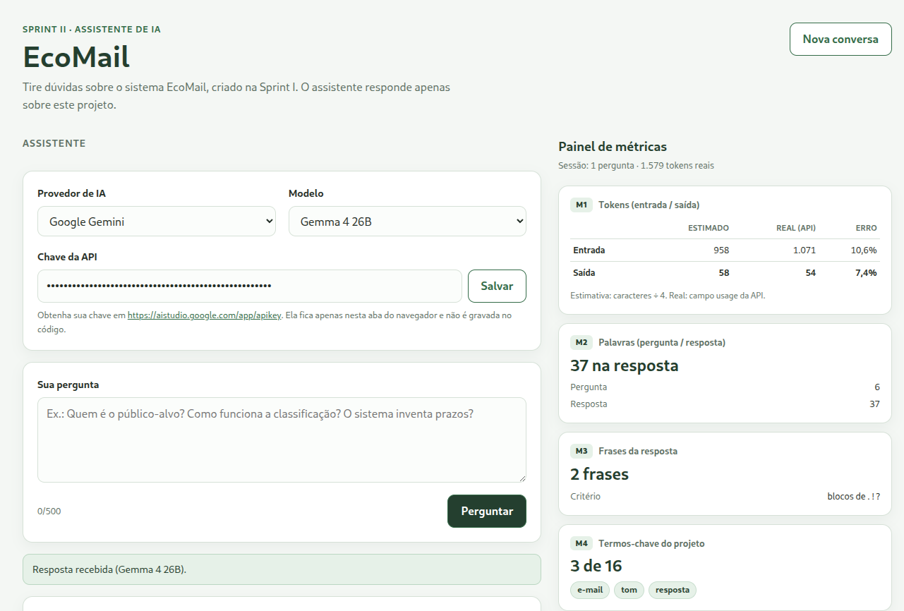

# EcoMail — Assistente de IA (Sprint II)

Assistente em **HTML + JavaScript puro** que responde dúvidas sobre o **EcoMail**,
sistema projetado na Sprint I. A página envia o contexto do projeto ao LLM e
calcula um painel de métricas a partir da pergunta e da resposta.



## Como rodar

```bash
python3 -m http.server 8000
```

Abra <http://localhost:8000>. Para os slides, abra
<http://localhost:8000/apresentacao.html>.

Não há build, npm ou dependências. Evite abrir por `file://`, pois o `fetch` e os
módulos ES podem ser bloqueados pelo navegador.

## Chave da API

A chave pode ser informada de duas formas:

1. **Na página:** cole no campo **Chave da API** e clique em **Salvar**. Ela fica
   no `sessionStorage` da aba.
2. **Em `js/env.js`:** copie `js/env.example.js` para `js/env.js`, preencha
   `GEMINI_API_KEY` e recarregue a página. O arquivo `js/env.js` está no
   `.gitignore` e não é commitado.

Obtenha a chave em <https://aistudio.google.com/app/apikey>.

> Não publique `js/env.js` em um site público e não o inclua no zip de entrega.

## Modelos

| Modelo | ID | Uso |
| --- | --- | --- |
| Gemma 4 26B | `gemma-4-26b-a4b-it` | padrão |
| Gemma 4 31B | `gemma-4-31b-it` | fallback |
| Gemini 3.5 Flash Lite | `gemini-3.5-flash-lite` | fallback |
| Gemini 3.1 Flash Lite | `gemini-3.1-flash-lite` | fallback |

Se o modelo escolhido falhar por limite (429), erro do servidor (5xx), modelo
indisponível (404) ou resposta vazia, o app tenta os demais automaticamente.
O Gemma devolve o raciocínio em uma parte com `thought: true`; o app descarta
essa parte e exibe apenas a resposta final.

Também há suporte a OpenAI (`gpt-4o-mini`) e Groq
(`llama-3.3-70b-versatile`). Os modelos ficam em `js/config.js` (`PROVEDORES`).

## Métricas

| Código | Métrica | Nível | Função |
| --- | --- | --- | --- |
| M1 | Tokens estimados × reais + erro | obrigatória | `estimarTokens`, `calcularErroPercentual` |
| M2 | Palavras da pergunta e da resposta | obrigatória | `contarPalavras` |
| M3 | Frases da resposta (`.`, `!`, `?`) | obrigatória | `contarFrases` |
| M4 | Termos-chave encontrados | obrigatória | `encontrarTermosChave` |
| M5 | Diversidade lexical | intermediário | `calcularDiversidadeLexical` |
| M6 | Índice de Flesch adaptado ao português | desafio | `calcularFlesch`, `contarSilabas` |

- **M1:** estimativa `Math.ceil(caracteres / 4)`; valores reais em
  `usageMetadata` (Gemini) ou `usage` (OpenAI/Groq); erro percentual com `n/d`
  quando o real não existe.
- **M3:** conta blocos de pontuação; `...` conta uma vez e `3.5` não conta.
- **M6:** `248,835 − 1,015 × (palavras/frases) − 84,6 × (sílabas/palavras)`.
  Sílabas são aproximadas por grupos de vogais. Sem pontuação, o cálculo usa 1
  frase para evitar divisão por zero.
- `contarFrases` e `contarSilabas` percorrem a string caractere a caractere.
- Todas as métricas são funções puras, sem bibliotecas.

## Estrutura

```
index.html            Página, formulário, resposta, histórico e painel
styles.css            Estilos e layout responsivo
apresentacao.html     Slides navegáveis (setas do teclado)
assets/               Captura de tela usada nos slides
js/config.js          Contexto, prompt, termos e provedores
js/api.js             Chamadas às APIs, JSON, erros e fallback
js/metrics.js         Funções puras das métricas
js/app.js             Eventos, estado da sessão e renderização
js/env.example.js     Modelo do arquivo local de chave
js/env.js             Chave local (ignorado pelo git, não versionado)
AI_LOG.md             Registro de uso de IA
```

## Segurança

- A chave não está no código, no HTML, no CSS nem nos arquivos versionados.
- `js/env.js` é ignorado pelo git; use-o apenas localmente.
- A chave é enviada no cabeçalho (`x-goog-api-key` ou `Authorization: Bearer`),
  nunca na URL.
- Mensagens de erro do provedor são limpas antes de aparecer na página.
- Resposta e histórico são renderizados com `textContent`, não `innerHTML`.

## Entrega

- Código-fonte sem `js/env.js`.
- `apresentacao.html` — slides.
- `AI_LOG.md` — registro de uso de IA.

## Autoria

Trabalho individual de **Vitor Mazzonetto**.
